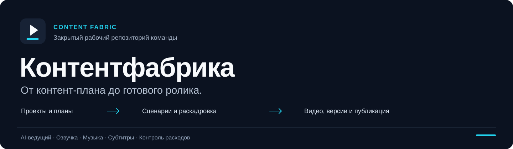

# Контентфабрика

Рабочий кабинет для производства коротких видео под бизнес. Проекты, контент-планы, сценарии, AI-ведущий, озвучка, монтаж и версии роликов собраны в одном процессе.

Закрытый репозиторий команды: исходный код приложения, тесты и инфраструктура развёртывания.

[Возможности](#возможности) · [Интеграции](#интеграции) · [Развёртывание](deploy/SETUP.txt) · [Архитектура](docs/architecture.md)

## От проекта до ролика

1. **Сохранить бизнес.** Описание продукта или услуги, язык, тему и предпочтения достаточно задать в проекте один раз.
2. **Собрать контент-план.** Выбрать 8, 12, 16 или 30 роликов на месяц; получить темы, хуки и цели. Каждый пункт открывается в AI Shorts как отдельная работа.
3. **Подготовить сценарий.** Использовать описание, URL или собственный текст. В раскадровке можно менять реплики, сцены и порядок кадров.
4. **Проверить голос и кадры.** Прослушать озвучку, посмотреть стартовые изображения и поправить материал до запуска видеогенерации.
5. **Собрать видео.** Выбрать ведущего, способ генерации, вставки, субтитры и музыкальную подложку.
6. **Доработать и выпустить.** Открыть ролик из галереи, переснять отдельные кадры, сохранить новую версию, скачать файл или отправить его на публикацию.

## Возможности

| Задача | Что есть в приложении |
|---|---|
| **Несколько проектов** | Отдельные бизнес-брифы и контент-планы; сохранение сценариев и этапов работы в аккаунте. |
| **Управляемая раскадровка** | Реплики и описание каждой сцены, добавление и перестановка кадров, выборочная пересъёмка, повторное использование готового материала. |
| **Ведущий и голос** | Загруженное фото, генерация или сохранённый актёр; привязка голоса к персонажу, предпрослушивание, lip-sync и повторное использование talking-head. |
| **Финальная сборка** | Вертикальный формат 9:16, субтитры, b-roll, музыка с выбором трека, предпрослушиванием и регулировкой громкости. |
| **Галерея и расходы** | Версии видео, возврат к раскадровке, смена музыки и разбивка расходов по этапам. Оценки отделены от подтверждённых сумм и неизвестных затрат. |
| **Дополнительные инструменты** | Нарезка длинного видео на клипы, YouTube-студия для обложек и текстов, публикация и планирование через Upload-Post. |

## Интеграции

| Сервис | Роль |
|---|---|
| **Google Gemini** | Анализ бизнеса и сайта, контент-планы, сценарии и постановка сцен. |
| **fal.ai** | Изображения, видео, AI-аватары и lip-sync; также MiniMax как вариант озвучки. |
| **ElevenLabs** | Озвучка с выбором голоса и модели. |
| **Upload-Post** | Публикация и планирование для TikTok, Instagram Reels и YouTube Shorts. |
| **AWS S3** | Необязательное облачное хранение клипов и материалов галереи. |

Свои API-ключи подключаются в настройках аккаунта. Стоимость и доступность генерации зависят от выбранных моделей, длительности, повторного использования материала и условий провайдеров.

## Разработка и эксплуатация

**Приложение:** React, Vite и Tailwind CSS · Python и FastAPI · SQLite · FFmpeg · Remotion.

**Поставка:** GitHub Actions → GitHub Container Registry → сервер с Docker Compose. Проверки и сборка образов выполняются в GitHub; обновление домашнего сервера включается отдельно. Конфигурация для N100 использует CPU-сборку backend и одну генерацию за раз.

| Документ | Для чего |
|---|---|
| [Развёртывание и CI/CD](deploy/SETUP.txt) | Подключить сервер, включить обновления, настроить ключи и сохранить данные. |
| [Архитектура](docs/architecture.md) | Разобраться в сервисах, обработке задач, хранении файлов и ограничениях текущей реализации. |
| [Права на собственные доработки](LICENSE) | Условия использования принадлежащих проекту изменений. |
| [Компоненты и уведомления](THIRD_PARTY_NOTICES.md) | Происхождение стороннего кода и относящиеся к нему условия. |
